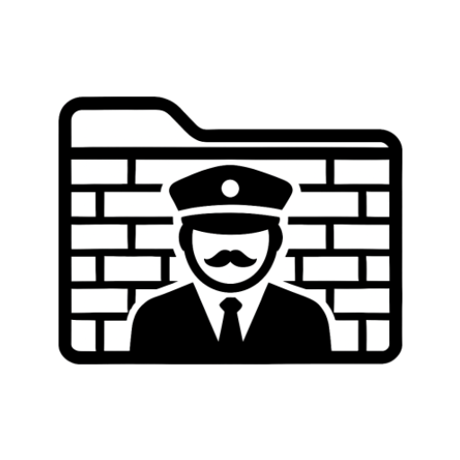
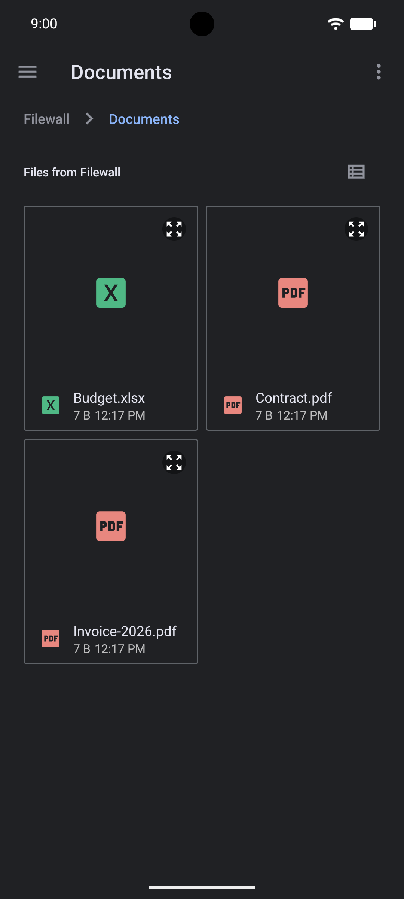
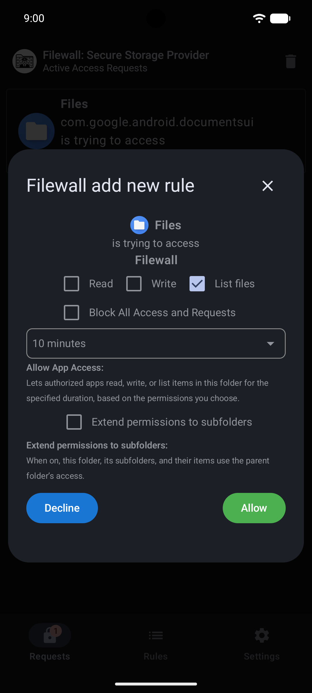
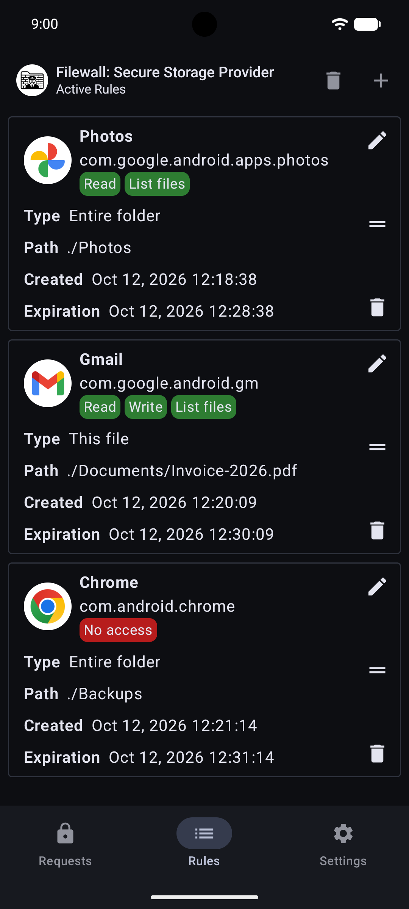
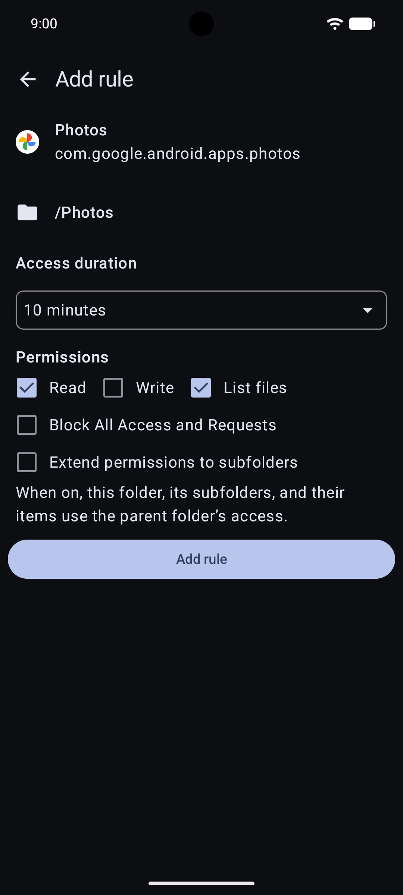
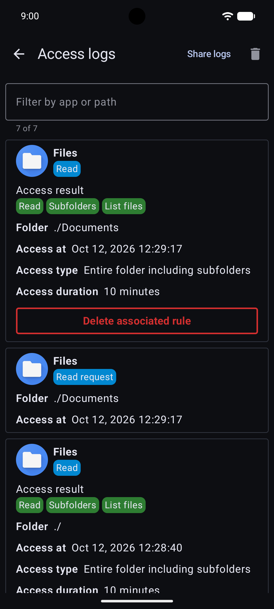

<p align="center">
  <picture>
    <source media="(prefers-color-scheme: dark)" srcset="docs/images/icon-dark.png">
    
  </picture>
</p>

<h1 align="center">Filewall</h1>

<p align="center">
  A file firewall for Android.<br>
  Choose which apps may read, write or list your files, with per-request approval, rules and access logs.<br>
  No root. No internet permission.
</p>

<p align="center">
  
  
  
</p>
<p align="center">
  
  
</p>

## What it is

Filewall keeps your files in its own private storage and lets other apps reach them only through
your rules. It plugs into Android's built-in file picker (the Storage Access Framework), so apps
need no special support.

## How it works

1. An app (or you, in the system file picker) opens Filewall as a storage location.
2. Filewall checks your rules, top to bottom. The first match applies, like a firewall.
3. If no rule covers the request, you get a notification and a request card. Allow it for a time
   you choose (this creates a rule), decline it, or block the app for a time you choose. One
   decision can answer a whole batch of requests.
4. With a PIN set, other apps' access asks for it too. It stays unlocked until the screen locks.

## Features

- Rules per app, per folder or per file: allow read, write or list, or block. A rule can extend to
  subfolders.
- Time-limited rules that expire on their own.
- Optional PIN, with fingerprint or face unlock. Wrong PINs lock you out for longer each time.
- An optional access log of what each app tried and why it was allowed or denied. It can be
  filtered, exported as CSV, and switched off.
- Silence mode: no dialogs or notifications, rules still enforced and logged.
- No account, no analytics and no network access: the app does not declare the Internet
  permission. No root needed.

## Things to know

- **The PIN is off until you set it.** Without it, anyone who opens the app can change the rules.
  Turn it on in Settings.
- **There is no PIN recovery.** If you lose it, you are locked out of the app.
- **Write on a folder also allows deleting it,** with everything inside, including items that have
  no rule of their own.
- **"Disable protection" turns block rules off.** Use it only briefly.
- **Your files exist only in Filewall's private storage.** Uninstalling the app or clearing its
  data deletes them, and they are not part of Android's cloud backup. Keep copies elsewhere.
- **Filewall does not encrypt anything.** It protects against other apps and accidental exposure
  on an unlocked device, not against root access or forensic tools.

## Permissions, and why

| Permission | Why |
|---|---|
| `POST_NOTIFICATIONS` | Tells you about access requests and blocked access (optional). |
| `USE_BIOMETRIC` | Fingerprint or face unlock in addition to the PIN (optional). |
| `RECEIVE_BOOT_COMPLETED` | Ends any open authentication session when the device restarts. |
| `QUERY_ALL_PACKAGES` | Lists your installed apps when you create a rule, and shows the name and icon of the app asking for access. Nothing is stored or sent anywhere. |

Two more entries appear in the manifest because of libraries: `USE_FINGERPRINT` (the pre-Android 9
name of the biometric permission) and `DYNAMIC_RECEIVER_NOT_EXPORTED_PERMISSION`, an internal
permission that only Filewall itself can hold. The app's Permission Disclosure lists everything.

Only the system file picker can reach Filewall's storage: it is protected by the system-only
`MANAGE_DOCUMENTS` permission.

## Install

Download `Filewall-v<version>.apk` from the
[Releases page](https://github.com/AndroidLabs-org/Filewall/releases). It needs Android 10 or
newer and is English only for now.

Every release is signed with the same key. To check it before installing (optional):

```
apksigner verify --print-certs Filewall-v1.0.0.apk
```

The SHA-256 digest of the signing certificate is:

```
845fe51c222dcfd69fd9fb0a8f1ad2e313c08ab95f6b261c2f8c3265e2b6715e
```

## Build from source

You need the Android SDK and JDK 21 (the version the release workflow uses).

```
./gradlew assembleRelease
```

Without a keystore the APK is left unsigned. The releases on GitHub are built and signed by
`.github/workflows/release.yml`.

## Open-source libraries

Filewall is built on AndroidX, Jetpack Compose, Accompanist, Reorderable and Kotlin, all under
the Apache License 2.0. The full list is in [NOTICE](NOTICE).

## Reporting a problem

Please use the [issue tracker](https://github.com/AndroidLabs-org/Filewall/issues) and fill in
the template: Android version, device model, app version and what you did. Do not post your PIN,
file names you consider private, or full logs without reading them first.

## License

Free software, licensed under the GNU General Public License v3 (see [LICENSE](LICENSE)).
Contact: info@androidlabs.org
